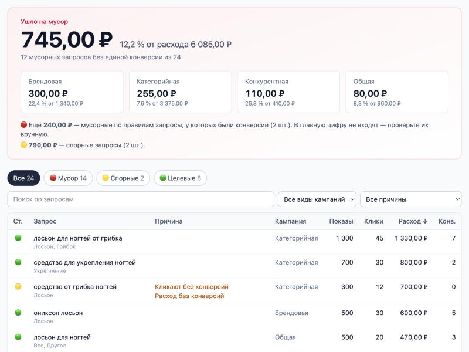
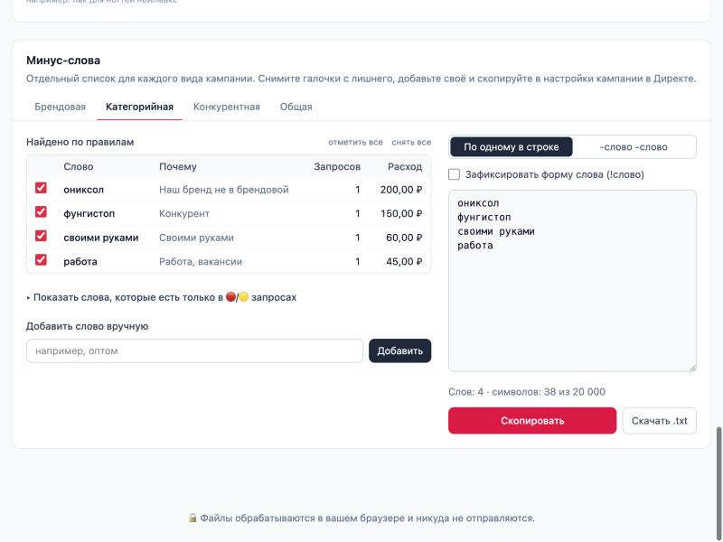

# Минусатор

Бесплатный веб-инструмент для чистки поисковых запросов Яндекс Директа.

Загрузите отчёт по поисковым запросам (CSV/XLSX) — получите мусорные запросы с причинами,
сумму бюджета, ушедшего на мусор, и готовые списки минус-слов — отдельно для брендовой,
категорийной, конкурентной и общей кампании.

🔒 Файлы обрабатываются в браузере и никуда не отправляются. Сервера нет.





## Как пользоваться

1. **Выгрузите отчёт из Директа**: «Поисковые запросы» или Мастер отчётов, формат XLSX или CSV.
   Служебные строки сверху (клиент, период) и строка «Итого» не мешают.
   Полезно, чтобы в отчёте были колонки «Название кампании», «Расход», «Клики», «Конверсии»
   и «Упоминания брендов в запросах» — обязательна только колонка с поисковым запросом.
2. **Перетащите файл на страницу.** Колонки найдутся сами; если нет — выберите их вручную.
3. **Проверьте виды кампаний.** Вид угадывается по названию: `brnd` — брендовая,
   `category` / `nbrnd` — категорийная, `cmpt` — конкурентная, `mix` и всё прочее — общая.
   Если неверно — поменяйте в списке.
4. **Заполните настройки клиента:**
   - слова бренда — вместе с латиницей и частыми опечатками (ониксол, oniksol, ониксал);
   - разрешённые конкуренты — кого разрешил заказчик;
   - прочие конкуренты — кого минусуем везде;
   - при необходимости — магазины, белый список, свой город, пороги по кликам и расходу.

   Настройки запоминаются в браузере. Для другого клиента — «Очистить настройки».
5. **Посмотрите сводку и таблицу.** 🔴 — мусор, 🟡 — спорно, 🟢 — целевой запрос.
   У каждого запроса написана причина. Если у мусорного запроса были конверсии,
   их число выделено зелёным — решите сами.
6. **«Похоже на бренды»** — слова, в которых Директ видит чужой бренд, а в ваших списках его нет.
   Отметьте: конкурент, магазин или не бренд.
7. **Скопируйте минус-слова** нужной вкладки и вставьте в настройки кампании в Директе.

### Что считается мусором

| Что в запросе | Брендовая | Категорийная | Конкурентная | Общая |
|---|---|---|---|---|
| Наш бренд | ок | 🔴 | 🔴 | ок |
| Нет нашего бренда | 🔴 | ок | — | ок |
| Разрешённый конкурент | 🔴 | 🔴 | ок | ок |
| Прочий конкурент | 🔴 | 🔴 | 🔴 | 🔴 |
| Магазин, аптека, маркетплейс | 🔴 | 🔴 | 🔴 | 🔴 |

Плюс во всех кампаниях — словари: бесплатное, вакансии, «своими руками», информационные
запросы (отзывы, инструкция, состав…), обучение, б/у, 18+. Каждый словарь можно выключить.

## Словари

Лежат в [`src/dictionaries`](src/dictionaries) — обычные списки слов в JSON.
Слова сравниваются по основам, поэтому достаточно одной формы: «бесплатно» поймает
«бесплатный» и «бесплатные». После правки словаря сайт нужно пересобрать (на GitHub — просто запушить).

## Для разработчика

Нужен Node.js 22.12 или новее.

```
npm install
npm run dev      # локальный сайт
npm test         # тесты
npm run build    # сборка в dist/
```

Стек: Vite + React + TypeScript + Tailwind, PapaParse (CSV), SheetJS (XLSX),
русский стеммер Snowball (`src/lib/stemmer.ts`). Логика — в `src/lib`, покрыта тестами на Vitest.
Тестовые отчёты и ожидаемые результаты — в [`samples`](samples).

Деплой: каждый пуш в `main` собирает сайт и публикует его на GitHub Pages
(`.github/workflows/deploy.yml`). В настройках репозитория: Settings → Pages → Source: **GitHub Actions**.
